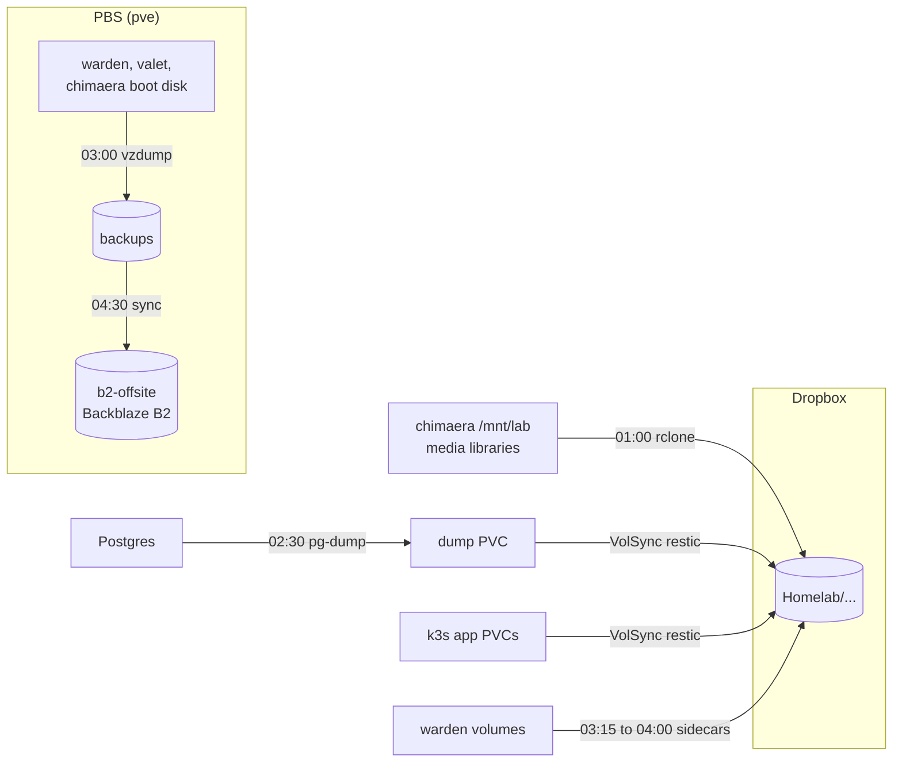

# Current State

For anything a running system can answer, query it. This file records only what nothing live reports.

## Hosts

| Host | What it is | Address | OS |
|---|---|---|---|
| `pve` | Proxmox VE hypervisor (physical, 6 cores) | `192.168.10.10` | Proxmox |
| `pbs` | Proxmox Backup Server (VM 102) | `192.168.10.11` | Proxmox |
| `warden` | Docker Compose host (VM 104). Runs the trusted-network services. | `192.168.10.12` | Debian 13 |
| `valet` | Personal assistant host (VM 105). Its config lives in the Moltron repo. Not on the tailnet. | `192.168.10.14` | Debian 13 |
| `chimaera` | Single-node k3s cluster (VM 100). Public entry point. | `192.168.40.10` | Debian 13 |
| `mrgutsy` | Cloud VM on OCI (ARM), Docker Compose. Address is not committed. | n/a | Ubuntu 26.04 |

Addressing on VLAN 10 (`192.168.10.0/24`):

| Range | Use |
|---|---|
| `.1`–`.9` | Network equipment |
| `.10`–`.19` | Servers and hypervisors |
| `.20`–`.29` | Reserved for other static hosts |
| `.100`–`.254` | DHCP |

VLAN 40 (`192.168.40.0/24`) has no ranges yet. `chimaera` takes `.10`, matching VLAN 10.

`mrgutsy` runs only voice and game traffic (TeamSpeak, Minecraft). It stays off the home network on purpose. Everything else runs on `pve`.

## Workloads

Each host's Caddy config (`compose/caddy/<host>/conf/Caddyfile`) is the authority on which host serves which route. These tables summarize it.

### warden

Trusted VLAN 10. Routes are internal only (`*.lan.$DOMAIN`).

| Service | Route |
|---|---|
| adguard-home | `adguard.lan.$DOMAIN` |
| monitoring-grafana | `grafana.lan.$DOMAIN` |
| speedtest-tracker | `speedtest.lan.$DOMAIN` |
| music-assistant | `mass.lan.$DOMAIN` |
| openclaw (runs on `valet`) | `openclaw.lan.$DOMAIN` |
| audiomuse-ai (runs on `chimaera`) | `audiomuse.lan.$DOMAIN` |
| caddy, doco-cd, docker-socket-proxy, oci-backup, porkbun-ddns, ppld-calendar, router-sync, icloudpd, icloudpd-telegram-bot, monitoring-prometheus, monitoring-node-exporter, monitoring-cadvisor, monitoring-adguard-exporter | None |

Notes:

- **doco-cd** polls this repo and deploys every stack above, itself included. Its own stack is defined in the root `.doco-cd.yaml`. A self-update restarts it briefly. It reaches Docker through `docker-socket-proxy`, which Ansible owns, so doco-cd never recreates its own connection.
- **router-sync** and **ppld-calendar** build from their own repos (`laforcem/router-sync`, `laforcem/ppld-calendar`). This repo holds only their deployment config.
- **icloudpd** stays on the trusted VLAN to keep Apple credentials out of the DMZ. It writes to the lab drive over NFS at `/mnt/lab/icloud`. It skips a user's run if `<user directory>/.mounted` is missing, which guards against a dropped mount.
- **music-assistant** runs on the host network because Cast discovery uses multicast. Ports:
  - `8095` (web UI): ufw allows `caddy-internal` only.
  - `8097` (audio stream): ufw allows `192.168.20.0/24`. The Cast speakers on the IoT VLAN fetch audio here. A router rule (`IOT_FWD`) also permits this traffic.

  Speakers are found through the router's Avahi mDNS reflector. Sources are set in the Music Assistant UI, not in git: Navidrome through the Subsonic provider, and Spotify through Soloist. The web server's Base URL is `https://mass.lan.$DOMAIN`. Soloist pairs on a random TCP port that ufw blocks, so re-pairing needs a temporary rule.

### chimaera

DMZ VLAN 40, k3s. The router forwards ports 80 and 443 here. That forward is set in the router GUI and is not tracked in git. Routes are public (`$DOMAIN`).

| Service | Route |
|---|---|
| actual | `budget.$DOMAIN` |
| actual-mcp | `budget.$DOMAIN/mcp` |
| audiobookshelf | `audiobooks.$DOMAIN` |
| immich | `photos.$DOMAIN` |
| miniflux | `miniflux.$DOMAIN` |
| navidrome | `music.$DOMAIN` (`nd.$DOMAIN` redirects here) |
| tandoor | `recipes.$DOMAIN` |
| audiomuse-ai | None publicly. Served at `audiomuse.lan.$DOMAIN` by warden. |
| samba | None. SMB on port 445. |
| media-backup | None. A nightly CronJob. |

Notes:

- Manifests are in `k3s/apps/`. Immich is a Helm release applied by hand (`helm upgrade --install`; see the header of `k3s/apps/immich/values.yaml`).
- Miniflux, Immich, Tandoor and AudioMuse each run their own Postgres.
- **Media** lives on the lab drive (`/mnt/lab`) as local persistent volumes. Navidrome mounts the music read-only. It rescans on file changes and once a day as a backstop.
- **AudioMuse** is reached through a NodePort that a NetworkPolicy limits to warden.
- **Samba** has one share, `[homelab]`, covering all of `/mnt/lab` for `malc` only. It accepts only the trusted LAN (`192.168.10.0/24`) and the pod network. A NetworkPolicy enforces this because ufw can't see the traffic. It is unreachable from the tailnet because `chimaera` is not on it. The password comes from Bitwarden through an ExternalSecret.
- **external-secrets** reads secrets from Bitwarden Secrets Manager through the `bitwarden-secretsmanager` ClusterSecretStore.
- **cert-manager** issues certificates from Let's Encrypt over HTTP-01. It creates a Certificate for an Ingress only if the Ingress has the `cert-manager.io/cluster-issuer` annotation. Traefik redirects HTTP to HTTPS except on ACME challenge paths.
- **CoreDNS override** (`k3s/infra/coredns-custom/`): inside the cluster, every public name `chimaera` serves resolves to `chimaera` itself. The DMZ can't reach its own public address (no hairpin NAT), so without this, cert-manager's self-check times out. Add each new app's hostname to that file.

### valet

Trusted VLAN 10. It is not on the tailnet; remote access goes through warden's subnet route. It runs OpenClaw, a personal assistant, directly on the host (not in Docker) on port 18789. Warden proxies it at `openclaw.lan.$DOMAIN`. Its config lives in the Moltron repo.

### mrgutsy

Public (`$DOMAIN`).

| Service | Route |
|---|---|
| teamspeak | Own subdomain, no Caddy. Raw UDP on 9987, so the DNS record points straight at the host. |
| girls-server (Minecraft, port 25570) | None |
| herobrines-mansion, mc-sloth-kingdom (Minecraft) | None. Stopped. |

A Caddy container holds the wildcard certificate and answers every web request with an abort, so it serves no site. TeamSpeak is an amd64-only image run under QEMU emulation (see `compose/teamspeak/README.md`). A probe on `chimaera` (`k3s/infra/external-probes/`) tests it every 5 minutes and reports to Healthchecks.

## Storage

`pve` has three pools. None is shared.

| Pool | Backing | Holds |
|---|---|---|
| `local-zfs` | 238 GiB NVMe, ZFS | VM boot disks |
| `truelab` | ~500 GB HDD, LVM-thin | The `chimaera` lab drive, mounted at `/mnt/lab`. Declared in `terraform/chimaera.tf` so applies don't detach it. |
| `pbs-b2-cache` | ~500 GB USB HDD | Two virtual disks for `pbs`: the local datastore `backups`, and the cache for the B2-backed datastore `b2-offsite` |

## Backup

All times are nightly unless noted.



The lab drive is excluded from PBS. Dropbox covers it.

### Whole VMs (PBS)

- One vzdump job at 03:00 backs up warden, valet and chimaera's boot disk to the `backups` datastore. The lab drive is excluded (`backup=0`) because it exceeds the datastore.
- A sync job (`backups-to-b2`, 04:30) copies `backups` to the Backblaze B2 datastore `b2-offsite` (bucket `starcliff-lab`). It does not remove vanished snapshots, so only B2's own prune job trims B2.
- Prune keeps 7 daily, 4 weekly and 3 monthly. `backups-prune` runs at 05:30 and `b2-offsite-prune` at 05:45. Garbage collection runs Sundays at 06:30 (local) and 07:00 (B2).
- The B2 bucket lifecycle must be "Keep only the last version of the file". With B2's default, PBS deletions free no space.
- Healthchecks monitors the vzdump and sync jobs through PVE and PBS webhook notifications.

### Media library

The `media-backup` CronJob (`k3s/apps/media-backup/`) runs at 01:00. It copies five `/mnt/lab` folders to Dropbox (`dropbox:Homelab/<name>`) with rclone: `icloud`, `immich` (thumbnails and encoded video excluded), `movies`, `music` and `audiobooks`. Changed and deleted files move to `<name>-deleted/<date>` and are pruned after 30 days. Each folder has its own Healthchecks check. Dropbox rate-limits small-file writes, so a run with many new iCloud sidecar files can take much longer.

### k3s app data (VolSync)

VolSync backs up PVCs with restic to `dropbox:Homelab/backups/<app>`. Retention is 7 daily, 4 weekly, 3 monthly.

| ReplicationSource | Time |
|---|---|
| `actual`, `immich`, `miniflux` | 03:00 |
| `audiobookshelf` | 03:15 |
| `navidrome-data`, `tandoor-media` | 03:30 |
| `audiomuse-dump`, `tandoor-dump` | 03:45 |

- Postgres is never backed up by copying its data directory. A `pg-dump` CronJob writes a dump to its own PVC, and VolSync backs up that PVC. This applies to Immich, Miniflux, Tandoor (02:30) and AudioMuse (02:40).
- The Immich ML model cache is not backed up. It can be re-downloaded.
- rclone needs the Dropbox app's client ID and secret, because the token is bound to that app.
- Never set `spec.trigger.manual` on a `ReplicationSource`. It pauses the schedule.

### warden volumes

An `offen/docker-volume-backup` sidecar tars each volume to Dropbox. Retention is 30 days. Healthchecks monitors each one.

| Volume | Time | Dropbox folder |
|---|---|---|
| `adguard-home_config` | 03:15 | `Homelab/adguard-home` |
| `speedtest-tracker` | 03:30 | `Homelab/speedtest-tracker` |
| `icloudpd_sessions` | 03:45 | `Homelab/icloudpd` |
| `music-assistant_data` | 04:00 | `Homelab/music-assistant` |

Grafana and Prometheus data are not backed up. Dashboards and datasources come from git, and metrics can be regenerated. The `oci-backup` service covers OCI resources (scope in `compose/oci-backup/README.md`). doco-cd's `/data` volume has no backup yet ([#95](https://github.com/laforcem/homelab/issues/95)).

## Network


Arrows show who starts the connection. The DMZ never starts one toward VLAN 10.

| VLAN | Bridge | Use |
|---|---|---|
| 10 | `br0` | Servers: `pve` and its VMs |
| 20 | `br52` | IoT |
| 30 | `br54` | Guest |
| 40 | `br53` | DMZ: `chimaera` |

The router enforces isolation between VLANs with custom iptables chains (`IOT_FWD`, `DMZ_FWD`, and others). The router's config lives on the router (`/jffs/scripts/`), not in this repo.

`warden` is the only Tailscale subnet router. It advertises `192.168.10.0/24` and `192.168.40.0/24`. It runs with `--accept-dns=false` because Tailscale DNS would conflict with AdGuard Home on port 53.

## Monitoring

- **Grafana** runs once, on warden. It queries `chimaera`'s Prometheus and Loki through NodePorts `30090` and `30100`. A NetworkPolicy and `externalTrafficPolicy: Local` limit both to warden (`192.168.10.12`). ufw can't restrict NodePorts. Nothing is pushed out of the cluster, and the DMZ never starts a connection to the trusted network.
- **In-cluster stack** (`k3s/infra/monitoring/`, three hand-run Helm releases in the `monitoring` namespace; see its README):
  - `kube-prometheus-stack`: Prometheus (10-day retention), node-exporter and kube-state-metrics. Grafana and Alertmanager are off.
  - `loki`: single binary, 14-day retention.
  - `alloy`: ships every container's logs to Loki.

  Prometheus scrapes Traefik, cert-manager and VolSync. VolSync's metrics sit behind an auth proxy, so Prometheus's ServiceAccount is bound to `volsync-metrics-reader` (`k3s/infra/volsync/metrics.*`).
- **Health probes**: Audiobookshelf, Immich, Miniflux, Navidrome and Tandoor each have a CronJob (`k3s/apps/<app>/health-probe.cronjob.yaml`, every 5 minutes) that checks the app and pings a Healthchecks check. Actual has none. TeamSpeak has a similar probe (see mrgutsy).

## Provisioning

### Terraform

`terraform/` provisions `pve` VMs with the `bpg/proxmox` provider. The API token comes from Bitwarden Secrets Manager. State is local. Files: `warden.tf`, `valet.tf`, `chimaera.tf`. A Debian 13 cloud-init template (VM 103, `debian-template`) is the base. `chimaera` is on VLAN 40 (`vlan_id = 40` on `vmbr0`). `warden` and `valet` use an untagged device on VLAN 10.

### Ansible

`ansible/` configures `warden` and `chimaera`. Run it from `ansible/` (see `ansible/README.md`):

```
set -a && source ../terraform/.env && set +a
ansible-playbook playbooks/main.yaml
```

| Role | Applies to | Does |
|---|---|---|
| `common` | All hosts | Sets hostname, installs `qemu-guest-agent`, unattended upgrades, timezone and NTP. Hardens SSH (no passwords, no root login). Configures ufw: deny by default; allow SSH and Tailscale; routed-traffic rules for warden's subnet-router role. |
| `utility-services` | warden | Frees port 53 from systemd-resolved. Installs Tailscale (reusable auth key from Bitwarden, rotated every 90 days), Docker with Compose, and doco-cd (bootstrapped once, then self-managing from git). Installs `nfs-common` and automounts `/mnt/lab/icloud` with `hard`, so an outage blocks writes instead of exposing the empty local mount point. |
| `k3s` | chimaera | Installs k3s with defaults (Traefik, ServiceLB, `local-path-provisioner`). Details below. |
| `cert-manager` | chimaera | Installs cert-manager with Helm, a `letsencrypt` ClusterIssuer (HTTP-01), and a Traefik config redirecting port 80 to 443 except for ACME challenges. |
| `valet-music` | valet | Mounts the music export at `/mnt/music`. Valet is otherwise managed from the Moltron repo and skips `common`. |

The `k3s` role:

- Sets `--tls-san k3s.lan.$DOMAIN` at install. The name is a manual AdGuard DNS rewrite to `192.168.40.10`, not tracked in git.
- Opens in ufw: `6443/tcp` (kube API) from the LAN and Tailscale (`100.64.0.0/10`); `80/tcp` and `443/tcp` from anywhere.
- Writes the kubeconfig to the operator's `~/.kube/config`, named `starcliff`.
- Mounts the lab drive at `/mnt/lab` (XFS, by UUID). It sets no `nofail`, so a missing drive fails the mount instead of letting local volumes land on the 32 GB root disk.
- Runs `nfs-kernel-server` and exports `/mnt/lab/icloud` to warden and `/mnt/lab/music` to valet. Each export goes to one host only, with `all_squash` and uid/gid 1000. ufw allows `2049/tcp` from those two hosts only.

## Known gaps

- **No alerting.** Grafana has no alert rules, and nothing alerts on VolSync metrics. A stopped backup once went unnoticed for nine days. Tracked in [#109](https://github.com/laforcem/homelab/issues/109).
- **AdGuard Home accounts** for `router-sync` and `monitoring-adguard-exporter` exist only in AdGuard's live config. A fresh deploy would not recreate them. AdGuard has no read-only role, so the exporter has full API access.
- **speedtest-tracker `/prometheus`** has no IP allowlist of its own. Caddy returns 404 for it on `speedtest.lan.$DOMAIN`, and Prometheus scrapes it container to container.
- **node-exporter** listens on host port `9100`. ufw allows it only from `172.21.0.0/16`, the `caddy-internal` network's subnet. If Docker recreates that network with a different subnet, Prometheus loses the target until the rule is updated.
- **Unpinned images:** `speedtest-tracker` and `router-sync` run `:latest`. They are the only ones; every k3s image is pinned.
- **Unused check:** the Healthchecks check `pvestatd Health (pve)` has never received a ping.
