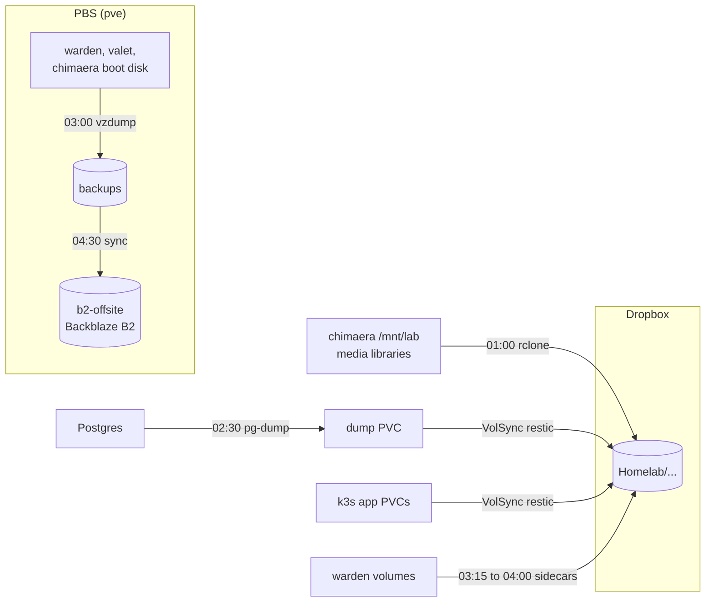
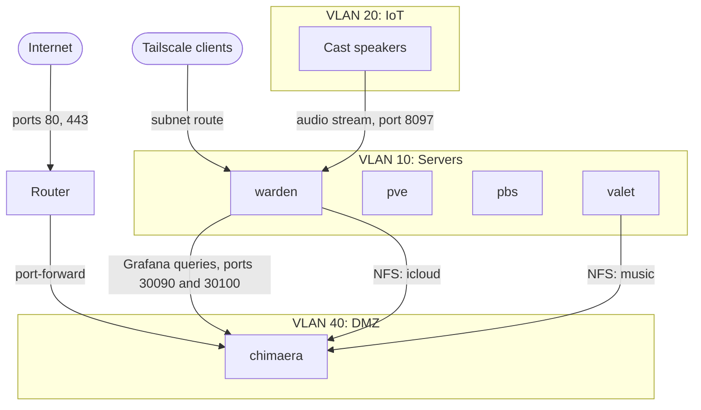

<!-- AI AGENTS: READ THIS
When editing this file, DO:
- Be as clear and concise as possible
- Write as few words as are grammatically necessary to convey important information
- Add information that is descriptive of the current state and nothing more
- Use technical terms when they are descriptive and necessary
- Include information about hardware, which is less mutable than software
DO NOT:
- Add any narratives, stories, or long tales
- Be overly verbose
- Use unnecessary jargon in places where plain English suffices
- Add information that will naturally rot: volume sizes, memory usage, or anything that could otherwise be accessed by pulling live state. Software is more mutable than software.
 -->

# Current State

Query live systems for anything they can answer. This file records only what they can't.

## Hosts

| Host | Role | Address | OS |
|---|---|---|---|
| `pve` | Proxmox hypervisor (physical, 6 cores) | `192.168.10.10` | Proxmox |
| `pbs` | Proxmox Backup Server (VM 102) | `192.168.10.11` | Proxmox |
| `warden` | Docker Compose host (VM 104), trusted-network services | `192.168.10.12` | Debian 13 |
| `valet` | Personal assistant host (VM 105), config in the Moltron repo | `192.168.10.14` | Debian 13 |
| `chimaera` | Single-node k3s cluster (VM 100), public entry point | `192.168.40.10` | Debian 13 |
| `mrgutsy` | OCI cloud VM (ARM), Docker Compose. Address not committed. | n/a | Ubuntu 26.04 |

VLAN 10 (`192.168.10.0/24`): `.1`–`.9` network equipment, `.10`–`.19` servers, `.20`–`.29` reserved for static hosts, `.100`–`.254` DHCP. VLAN 40 (`192.168.40.0/24`) has no ranges yet.

`mrgutsy` runs only voice and game traffic, which stays off the home network on purpose.

## Workloads

Each host's Caddy config (`compose/caddy/<host>/conf/Caddyfile`) is the authority on routes. These tables summarize it.

### warden

Trusted VLAN 10. Routes are internal (`*.lan.$DOMAIN`).

| Service | Route |
|---|---|
| adguard-home | `adguard.lan.$DOMAIN` |
| monitoring-grafana | `grafana.lan.$DOMAIN` |
| speedtest-tracker | `speedtest.lan.$DOMAIN` |
| music-assistant | `mass.lan.$DOMAIN` |
| openclaw (runs on `valet`) | `openclaw.lan.$DOMAIN` |
| audiomuse-ai (runs on `chimaera`) | `audiomuse.lan.$DOMAIN` |
| caddy, doco-cd, docker-socket-proxy, oci-backup, porkbun-ddns, ppld-calendar, router-sync, icloudpd, icloudpd-telegram-bot, monitoring-prometheus, monitoring-node-exporter, monitoring-cadvisor, monitoring-adguard-exporter | None |

- **doco-cd** polls this repo and deploys every stack, itself included (its stack is in the root `.doco-cd.yaml`). A self-update restarts it briefly. It reaches Docker through `docker-socket-proxy`, which Ansible owns, so doco-cd never recreates its own connection.
- **router-sync** and **ppld-calendar** build from their own repos (`laforcem/router-sync`, `laforcem/ppld-calendar`). This repo holds only their deployment config.
- **icloudpd** stays on the trusted VLAN to keep Apple credentials out of the DMZ. It writes to the lab drive over NFS at `/mnt/lab/icloud` and skips a user's run if `<user directory>/.mounted` is missing, which guards against a dropped mount.
- **music-assistant** uses the host network because Cast discovery is multicast. Ufw allows the web UI (`8095`) from `caddy-internal` only, and the audio stream (`8097`) from the IoT VLAN, where the Cast speakers fetch it. The router's `IOT_FWD` chain also permits this. The router's Avahi mDNS reflector lets it find the speakers. Sources (Navidrome via Subsonic, Spotify via Soloist) are set in its UI, not git. Soloist pairs on a random TCP port that ufw blocks, so re-pairing needs a temporary rule.

### chimaera

DMZ VLAN 40, k3s. The router forwards ports 80 and 443 here (set in the router GUI, not tracked in git). Routes are public (`$DOMAIN`).

| Service | Route |
|---|---|
| actual | `budget.$DOMAIN` |
| actual-mcp | `budget.$DOMAIN/mcp` |
| audiobookshelf | `audiobooks.$DOMAIN` |
| immich | `photos.$DOMAIN` |
| miniflux | `miniflux.$DOMAIN` |
| navidrome | `music.$DOMAIN` (`nd.$DOMAIN` redirects here) |
| tandoor | `recipes.$DOMAIN` |
| audiomuse-ai | None. Warden serves it. |
| samba | None. SMB on port 445. |
| media-backup | None. Nightly CronJob. |

- Manifests are in `k3s/apps/`. Immich is a Helm release applied by hand (see the header of `k3s/apps/immich/values.yaml`).
- Miniflux, Immich, Tandoor and AudioMuse each run their own Postgres.
- Media sits on the lab drive (`/mnt/lab`) as local persistent volumes. Navidrome mounts music read-only and rescans on file changes, plus daily.
- AudioMuse is reached through a NodePort that a NetworkPolicy limits to warden.
- **Samba** has one share, `[homelab]`, covering `/mnt/lab` for `malc` only. A NetworkPolicy limits it to the trusted LAN and the pod network, because ufw can't see this traffic. The tailnet can't reach it. The password comes from Bitwarden through an ExternalSecret.
- **external-secrets** reads Bitwarden Secrets Manager through the `bitwarden-secretsmanager` ClusterSecretStore.
- **cert-manager** issues Let's Encrypt certificates over HTTP-01, only for Ingresses annotated `cert-manager.io/cluster-issuer`. Traefik redirects HTTP to HTTPS except on ACME challenge paths.
- **CoreDNS override** (`k3s/infra/coredns-custom/`): inside the cluster, each public name resolves straight to `chimaera`. The DMZ can't reach its own public address (no hairpin NAT), so cert-manager's self-check would time out. Add each new app's hostname to that file.

### valet

Trusted VLAN 10, not on the tailnet (remote access goes through warden's subnet route). It runs OpenClaw directly on the host, not in Docker, on port 18789. Warden proxies it.

### mrgutsy

Public (`$DOMAIN`).

| Service | Route |
|---|---|
| teamspeak | Own subdomain, no Caddy. Raw UDP on 9987, so DNS points straight at the host. |
| girls-server (Minecraft, port 25570) | None |
| herobrines-mansion, mc-sloth-kingdom (Minecraft) | None. Stopped. |

A Caddy container holds the wildcard certificate and aborts every web request, so it serves no site. TeamSpeak is amd64-only and runs under QEMU emulation (see `compose/teamspeak/README.md`). A probe on `chimaera` (`k3s/infra/external-probes/`) tests it every 5 minutes and reports to Healthchecks.

## Storage

`pve` has three pools. None is shared.

| Pool | Backing | Holds |
|---|---|---|
| `local-zfs` | 238 GiB NVMe, ZFS | VM boot disks |
| `truelab` | ~500 GB HDD, LVM-thin | `chimaera`'s lab drive at `/mnt/lab`. Declared in `terraform/chimaera.tf` so applies don't detach it. |
| `pbs-b2-cache` | ~500 GB USB HDD | Two `pbs` virtual disks: the local datastore `backups` and the cache for the B2 datastore `b2-offsite` |

## Backup

Times are nightly. The lab drive is excluded from PBS (`backup=0`, too big for the datastore) and covered by Dropbox.



### Whole VMs (PBS)

- A sync job (`backups-to-b2`) copies `backups` to the B2 datastore `b2-offsite` (bucket `starcliff-lab`). It never removes vanished snapshots, so only B2's own prune job trims B2.
- Both datastores keep 7 daily, 4 weekly and 3 monthly snapshots. Prune runs at 05:30 (`backups`) and 05:45 (`b2-offsite`). Garbage collection runs Sundays at 06:30 and 07:00.
- The B2 bucket lifecycle must be "Keep only the last version of the file". With B2's default, PBS deletions free no space.
- Healthchecks monitors the vzdump and sync jobs through webhook notifications.

### Media library

The `media-backup` CronJob (`k3s/apps/media-backup/`) copies `icloud`, `immich` (thumbnails and encoded video excluded), `movies`, `music` and `audiobooks` from `/mnt/lab` to `dropbox:Homelab/<name>` with rclone. Changed and deleted files move to `<name>-deleted/<date>` for 30 days. Each folder has its own Healthchecks check. Dropbox rate-limits small-file writes, so a run with many new iCloud sidecar files can run long.

### k3s app data (VolSync)

VolSync backs up PVCs with restic to `dropbox:Homelab/backups/<app>`, keeping 7 daily, 4 weekly and 3 monthly.

| ReplicationSource | Time |
|---|---|
| `actual`, `immich`, `miniflux` | 03:00 |
| `audiobookshelf` | 03:15 |
| `navidrome-data`, `tandoor-media` | 03:30 |
| `audiomuse-dump`, `tandoor-dump` | 03:45 |

- Postgres is never backed up by copying its data directory. A `pg-dump` CronJob writes a dump to its own PVC, and VolSync backs up that PVC (Immich, Miniflux, Tandoor at 02:30; AudioMuse at 02:40).
- The Immich ML model cache is not backed up.
- rclone needs the Dropbox app's client ID and secret, because the token is bound to that app.
- Never set `spec.trigger.manual` on a `ReplicationSource`. It pauses the schedule.

### warden volumes

An `offen/docker-volume-backup` sidecar tars each volume to Dropbox, keeping 30 days. Healthchecks monitors each.

| Volume | Time | Dropbox folder |
|---|---|---|
| `adguard-home_config` | 03:15 | `Homelab/adguard-home` |
| `speedtest-tracker` | 03:30 | `Homelab/speedtest-tracker` |
| `icloudpd_sessions` | 03:45 | `Homelab/icloudpd` |
| `music-assistant_data` | 04:00 | `Homelab/music-assistant` |

Not backed up: Grafana and Prometheus data (dashboards come from git, metrics regenerate) and doco-cd's `/data` volume ([#95](https://github.com/laforcem/homelab/issues/95)). `oci-backup` covers OCI resources (see `compose/oci-backup/README.md`).

## Network



Arrows show who starts the connection. The DMZ never starts one toward VLAN 10.

| VLAN | Bridge | Use |
|---|---|---|
| 10 | `br0` | Servers |
| 20 | `br52` | IoT |
| 30 | `br54` | Guest |
| 40 | `br53` | DMZ |

The router isolates VLANs with custom iptables chains (`IOT_FWD`, `DMZ_FWD`, others). Its config lives on the router (`/jffs/scripts/`), not in this repo.

`warden` is the only Tailscale subnet router, advertising `192.168.10.0/24` and `192.168.40.0/24`. It runs `--accept-dns=false` because Tailscale DNS would conflict with AdGuard Home on port 53.

## Monitoring

- **Grafana** runs once, on warden, and queries `chimaera`'s Prometheus and Loki over NodePorts `30090` and `30100`. A NetworkPolicy and `externalTrafficPolicy: Local` limit both to warden, because ufw can't restrict NodePorts. Nothing is pushed out of the cluster.
- **In-cluster stack** (`k3s/infra/monitoring/`; three hand-run Helm releases, see its README): `kube-prometheus-stack` (Prometheus with 10-day retention, node-exporter, kube-state-metrics; Grafana and Alertmanager off), `loki` (14-day retention) and `alloy` (ships container logs to Loki).
- Prometheus scrapes Traefik, cert-manager and VolSync. VolSync's metrics sit behind an auth proxy, so Prometheus's ServiceAccount is bound to `volsync-metrics-reader` (`k3s/infra/volsync/metrics.*`).
- **Health probes**: Audiobookshelf, Immich, Miniflux, Navidrome and Tandoor each run a CronJob every 5 minutes (`k3s/apps/<app>/health-probe.cronjob.yaml`) that pings a Healthchecks check. Actual has none.

## Provisioning

**Terraform** (`terraform/`) provisions `pve` VMs with the `bpg/proxmox` provider: `warden.tf`, `valet.tf`, `chimaera.tf`, cloned from a Debian 13 cloud-init template (VM 103). The API token comes from Bitwarden Secrets Manager. State is local. `chimaera` uses `vlan_id = 40` on `vmbr0`; `warden` and `valet` are untagged (VLAN 10).

**Ansible** (`ansible/`) configures `warden` and `chimaera`. From `ansible/` (see its README):

```
set -a && source ../terraform/.env && set +a
ansible-playbook playbooks/main.yaml
```

| Role | Hosts | Does |
|---|---|---|
| `common` | All | Hostname, `qemu-guest-agent`, unattended upgrades, timezone, NTP. SSH hardening (no passwords, no root). ufw deny-by-default with SSH and Tailscale allowed, plus routing rules for warden's subnet-router role. |
| `utility-services` | warden | Frees port 53 from systemd-resolved. Installs Tailscale (reusable Bitwarden auth key, rotated every 90 days), Docker with Compose, and doco-cd (bootstrapped once, then self-managing from git). Automounts `/mnt/lab/icloud` over NFS with `hard`, so an outage blocks writes instead of exposing the empty local mount point. |
| `k3s` | chimaera | See below. |
| `cert-manager` | chimaera | cert-manager (Helm), a `letsencrypt` ClusterIssuer (HTTP-01), and Traefik's HTTP-to-HTTPS redirect. |
| `valet-music` | valet | Mounts the music export at `/mnt/music`. Valet otherwise comes from the Moltron repo and skips `common`. |

The `k3s` role:

- Installs k3s with defaults (Traefik, ServiceLB, `local-path-provisioner`) and `--tls-san k3s.lan.$DOMAIN`. That name is a manual AdGuard DNS rewrite to `192.168.40.10`, not tracked in git.
- Opens ufw for `6443/tcp` (kube API) from the LAN and Tailscale (`100.64.0.0/10`), and `80/tcp` and `443/tcp` from anywhere.
- Writes the kubeconfig to the operator's `~/.kube/config`, named `starcliff`.
- Mounts the lab drive at `/mnt/lab` (XFS, by UUID) with no `nofail`: a missing drive fails the mount instead of letting volumes land on the 32 GB root disk.
- Exports `/mnt/lab/icloud` to warden and `/mnt/lab/music` to valet over NFS, each to one host only (`all_squash`, uid/gid 1000). Ufw allows `2049/tcp` from those two hosts only.

## Known gaps

- **No alerting.** Grafana has no alert rules, and nothing alerts on VolSync metrics. Tracked in [#109](https://github.com/laforcem/homelab/issues/109).
- **AdGuard accounts** for `router-sync` and `monitoring-adguard-exporter` exist only in AdGuard's live config, so a fresh deploy loses them. AdGuard has no read-only role, so the exporter has full API access.
- **speedtest-tracker `/prometheus`** has no IP allowlist. Caddy returns 404 for it on `speedtest.lan.$DOMAIN`, and Prometheus scrapes it container to container.
- **node-exporter** (host port `9100`) is allowed through ufw only from `172.21.0.0/16`, the `caddy-internal` subnet. If Docker recreates that network on a different subnet, Prometheus loses the target until the rule is updated.
- **Unpinned images:** `speedtest-tracker` and `router-sync` run `:latest`. Every k3s image is pinned.
- **Dead check:** `pvestatd Health (pve)` in Healthchecks has never received a ping.
